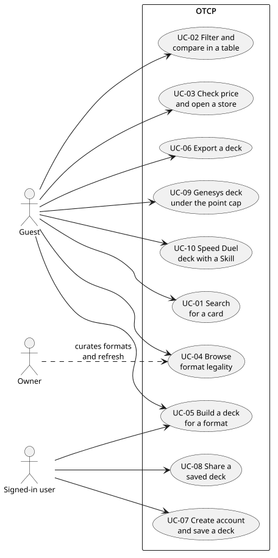
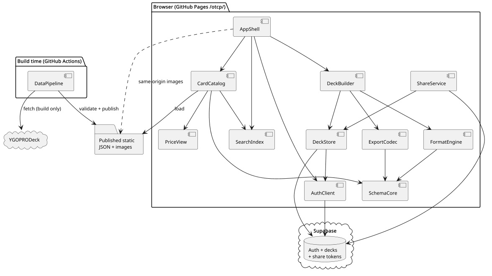
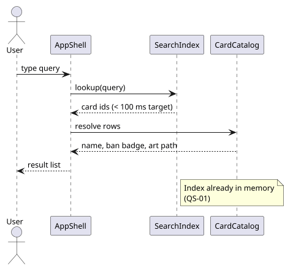
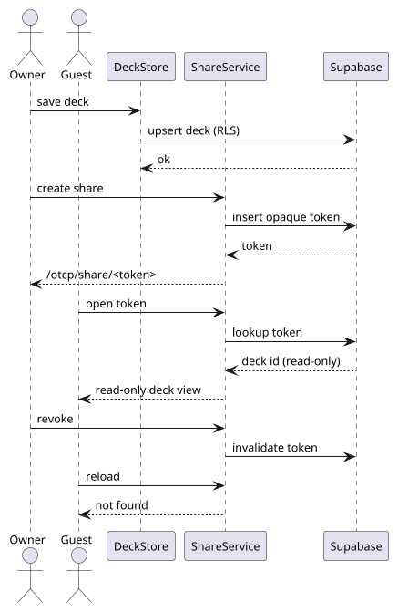
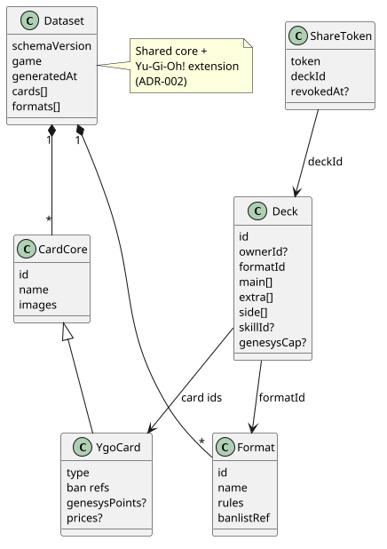
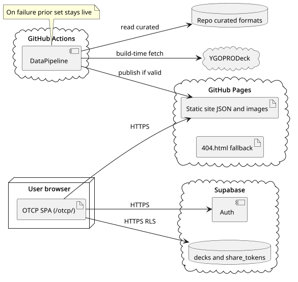
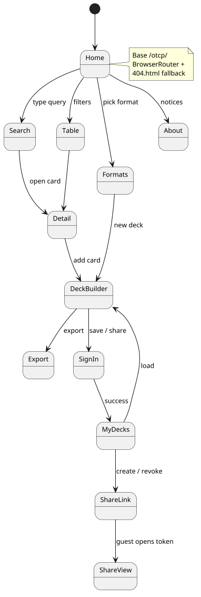
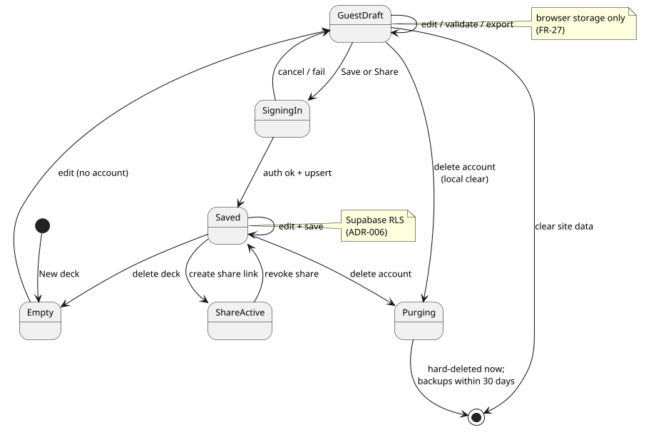

# Architecture and Design: OTCP

Prepared by: Filliciano Plong · Date: October 27, 2026 · Version: 1.0

**Readers:** Filliciano Plong, developer and tester of OTCP. Status: Approved 2026-10-27. Helps decide module boundaries, the data pipeline, and the auth path before code grows.

## Contents

- [Revision history](#revision-history)
- [1. Context and scope](#1-context-and-scope)
- [2. Goals and constraints](#2-goals-and-constraints)
- [3. Quality-attribute scenarios](#3-quality-attribute-scenarios)
- [4. Architectural style](#4-architectural-style)
- [5. Architecture views](#5-architecture-views)
- [6. Behavior and contract](#6-behavior-and-contract)
- [7. Architecture decisions](#7-architecture-decisions)
- [8. Risks](#8-risks)
- [9. Technology stack](#9-technology-stack)
- [10. Traceability](#10-traceability)
- [11. Open decisions](#11-open-decisions)
- [12. Maintenance and references](#12-maintenance-and-references)

## Revision history

| Version | Date | Changes |
|---|---|---|
| 1.0 | October 27, 2026 | Approved by Filliciano Plong. First release of the architecture. Based on approved SRS 1.0. |

**Status:** Approved 2026-10-27 by Filliciano Plong. Based on approved SRS 1.0.

## 1. Context and scope

This document shows how OTCP will meet its approved SRS. It cites requirement IDs from the SRS (Plong_OTCP_SRS.docx, version 1.0) instead of repeating them.

Architecture 1.0 is approved. Technology versions marked UNVERIFIED stay open until the spikes in section 9 confirm them.

### 1.1 Actors

| Actor | Role |
|---|---|
| Guest | Browses cards, builds and exports decks in the browser without an account. |
| Signed-in user | Saves decks, creates and revokes share links, deletes the account. |
| Owner (Filliciano) | Runs the refresh workflow, curates formats and overrides, ships pages. |
| GitHub Pages | Hosts the static UI and published card/image assets under /otcp/. |
| Supabase | Auth (email/password and Google) and persisted decks for signed-in users. |
| YGOPRODeck | Upstream card, price, and Genesys point data ingested at build time only. |
| GitHub Actions | Weekly and manual data refresh with validation before publish. |

### 1.2 External dependencies

- Vite 7, React 19, TypeScript, Tailwind CSS 4 (proposal, ADR-001).
- Vitest and Playwright (Chromium-only) for tests (ADR-001).
- Node.js 22 pinned for local and CI builds (ADR-001).
- Supabase free tier for auth and saved decks (ADR-006).
- YGOPRODeck API at build time only; images re-hosted (ADR-003, NFR-05).
- Konami public banlist and Genesys pages for spot-checks (ADR-005, ADR-004).

### 1.3 Included and excluded

**Included:** SRS sections 6 and 7: every FR and NFR, Must and Should.

**Excluded:** The SRS out-of-scope list (section 2.2) and Future features (section 13).

## 2. Goals and constraints

### 2.1 Top quality goals

| Rank | Goal | Requirements |
|---|---|---|
| 1 | Fast mid-game card search on a phone | NFR-01, NFR-02, ADR-009 |
| 2 | Trusted formats and ban status without live scrape | FR-12, FR-14, ADR-004 |
| 3 | Safe accounts and share links on free tier | NFR-04, NFR-07, ADR-006, ADR-007 |
| 4 | Refresh that never ships a broken catalog | NFR-08, ADR-003 |

### 2.2 Constraints

| Constraint | Source |
|---|---|
| Static UI on GitHub Pages under base path /otcp/ | OD-09, ADR-001 |
| No TCGplayer API; prices come through YGOPRODeck plus store deep links | OD-03, ADR-008 |
| Yu-Gi-Oh! TCG only in the first release | FR-50 |
| Solo developer; Shoulds cut in the SRS drop order | Project plan |
| Hand-curated formats; Format Library is UX reference only | OD-01, ADR-004 |
| English interface | SRS section 5 |

## 3. Quality-attribute scenarios

Each scenario names a stimulus and environment, the expected response, a measure, and how it is checked.

| ID | Stimulus and environment | Response and measure | Verification | IDs | Component |
|---|---|---|---|---|---|
| QS-01 | User types in the search box on the reference phone after the card index has loaded. | Matching results appear within 100 ms of the last keystroke (target). | Test: input-latency timing on the reference phone | FR-01, FR-02, NFR-01 | SearchIndex |
| QS-02 | Cold open of /otcp/ on the reference phone on a typical mobile network. | Home experience interactive within 2 s (target). | Test: Lighthouse or timed navigation | NFR-02 | AppShell, CardCatalog |
| QS-03 | Weekly or manual refresh pulls an invalid card record from upstream. | Validation fails; the previous published dataset stays live. | Test: inject invalid record in CI fixture | FR-52, FR-53, NFR-08 | DataPipeline |
| QS-04 | Guest builds a deck, signs in, and saves; another browser signs in and loads it. | Deck appears for the same account; guest local draft is offered for import once per browser profile; decline is permanent for that draft; never overwrite a saved deck without explicit replace. | Test: UC-07 across two browsers; decline then re-sign-in does not re-prompt for the same draft | FR-27, FR-36, FR-38, NFR-04 | AuthClient, DeckStore |
| QS-05 | Owner creates a share link; a guest opens it; owner revokes; guest reloads. | Guest sees a read-only deck until revoke; after revoke the link returns not found. | Test: UC-08 create, open, revoke | FR-41, FR-42, FR-43 | ShareService |
| QS-06 | User confirms account deletion. | Auth identity, personal decks, and share tokens are hard-deleted immediately in the live store; only provider backups may remain until they age out within 30 days. | Test: delete account; cannot sign in and decks/shares gone at once; confirm no live rows remain | FR-35, NFR-07 | AuthClient, DeckStore, ShareService |
| QS-07 | User completes UC-01, UC-05, and UC-06 by keyboard only on a primary screen. | Every control is reachable; ban status is not color-only; axe reports no AA blockers. | Test: keyboard path plus axe | NFR-09, NFR-10, NFR-11 | AppShell, DeckBuilder |

## 4. Architectural style

OTCP is a static single-page app on GitHub Pages with a build-time data pipeline and a small BaaS (Supabase) for auth, saved decks, want lists, and collection. The browser never calls YGOPRODeck for images or card JSON at runtime. Domain logic (schema, format rules, export codecs, search index) lives in modules that run under Node in tests (NFR-14).

| Component | Process | Responsibility |
|---|---|---|
| AppShell | Browser | Routing under /otcp/, layout, Ink chrome, Stack favicon V1 Mono charcoal, Match-system theme via prefers-color-scheme and data-theme, tokens from docs/ui/tokens.css (Tailwind @theme), hamburger phone nav (Search, Formats, Decks, Collection, Lists, Account — no separate Builder), view preference: customizable Table is the default on Search/Lists/Collection at ≥~640 CSS px (List/Grid toggles remain); under that width those screens use compact icon rows (List) with no Table; shared live count line (same format as search results) above the results; table column layouts via DataTable/ColumnConfigStore; notices page |
| SearchIndex | Browser | In-memory name/id index plus inverted bitsets per facet value for typed search and facet counts under the 100 ms target |
| FilterEngine | Browser / Node | Applies declared core + game-extension facet definitions; include/exclude and AND/OR; returns match ids and per-option counts; UI-agnostic |
| CardCatalog | Browser | Loads published card JSON (including misc_info and card_prices/card_sets needed for addable table columns); hosts filter panel from declarations; default desktop Table on Search/Lists/Collection with compact icon rows on phone; stacked or two-column detail; same-origin art |
| ValueSummary | Browser | Shared summary bar for Collection, Lists, and Decks (the only place price/P/L stats appear — count line above results is card count only, same live format as Search): Total current value (market×qty, or my_value×qty when set — Must), Total paid (purchase×qty over priced items; on Lists purchase = what the user paid / expects to pay), Profit/loss over priced items, priced-count label; Market = YGOPRODeck card_prices.tcgplayer_price; deck totals inherit purchase/my_value from matching collection printings when present |
| DataTable | Browser | Shared desktop Table (default view ≥~640) for Search, Lists, and Collection: default columns per screen, sort, per-column filter, drag-reorder, resize, header context menu + keyboard Columns control; ColumnConfigStore remembers and restores the full setup (visible columns, order, widths, sort, active filters) per table key on reopen (localStorage when signed out; profiles.table_column_prefs when signed in); not used on phone — compact icon rows instead |
| FormatEngine | Browser / Node | Format catalog, ban status, Genesys points and caps, Speed Skill rules |
| DeckBuilder | Browser | Main / Extra / Side (and Skill where needed); CardFinder (shared with want-list and collection editors); List/Grid sections; counts; Genesys points; owned/missing vs collection; ValueSummary (current / paid / P/L); live validation; opened from Decks (no separate Builder primary-nav route) |
| ExportCodec | Browser / Node | YDK (Skill under #main), YDKE, TCGplayer Mass Entry, plain text; import YDK |
| AuthClient | Browser | Supabase email/password and Google sign-in; session; account delete request |
| DeckStore | Browser + Supabase | Guest drafts in browser storage; signed-in decks in Supabase |
| WantListStore | Browser + Supabase | Guest Lists (want lists) in browser storage; signed-in Lists in Supabase; UI label Lists; price totals from published snapshot |
| CollectionStore | Browser + Supabase | Guest collection in browser storage; signed-in collection in Supabase; feeds deck owned/missing |
| ShareService | Browser + Supabase | Opaque tokens for decks and want lists; read-only share pages; revoke |
| PriceView | Browser | Shows published prices; opens store deep links in a new tab |
| SchemaCore | Node / Browser | Versioned shared core + Yu-Gi-Oh! extension; validation |
| DataPipeline | GitHub Actions | Fetch YGOPRODeck, validate, re-host images, publish or keep prior set |

## 5. Architecture views

Each view is a PlantUML source in docs/diagrams/. Component names match the table in section 4.

### 5.1 Use-case view

*Figure 1. Figure 1. Use cases for guests and signed-in users.*

**Purpose:** Map actors to the ten SRS use cases.

**Assumption:** One product under /otcp/; no separate mobile app.

**Limitation:** Does not show refresh or curation workflows the owner runs offline.

### 5.2 Component view

*Figure 2. Figure 2. Runtime and build-time components.*

**Purpose:** Show module boundaries and which side owns data.

**Assumption:** Component names match section 4.

**Limitation:** Internal React component trees are omitted.

### 5.3 Sequence: typed search

*Figure 3. Figure 3. Search after the index is loaded.*

**Purpose:** Show the path that must stay under 100 ms (QS-01).

**Assumption:** Index already loaded in memory.

**Limitation:** Cold-load of the index is covered by QS-02, not this figure.

### 5.4 Sequence: save and share

*Figure 4. Figure 4. Save a deck and create a share link.*

**Purpose:** Show Supabase writes and the opaque token.

**Assumption:** User is already signed in.

**Limitation:** Guest localStorage path is separate (ADR-006).

### 5.5 Class: schema and deck

*Figure 5. Figure 5. Core schema types and a deck document.*

**Purpose:** Anchor the versioned schema and format attachment points.

**Assumption:** Yu-Gi-Oh! extension is the only game pack in v1.

**Limitation:** Wire format field names may change in a later schema version.

### 5.6 Deployment view

*Figure 6. Figure 6. GitHub Pages, Actions, Supabase, and upstream.*

**Purpose:** Show trust boundaries and where secrets live.

**Assumption:** Pages serves only HTTPS (NFR-03).

**Limitation:** Supabase project sizing is UNVERIFIED until spike S-02.

### 5.7 Screen flow

*Figure 7. Figure 7. Primary screens and navigation.*

**Purpose:** Match the SRS screen map without repeating its table.

**Assumption:** Base path /otcp/ with BrowserRouter and 404.html fallback.

**Limitation:** Exact visual layout belongs in the UI stage.

### 5.8 State: deck session

*Figure 8. Figure 8. Guest draft vs signed-in saved deck.*

**Purpose:** Clarify when browser storage and Supabase apply.

**Assumption:** One active deck editor at a time in v1.

**Limitation:** Conflict if two tabs edit the same saved deck is out of scope for v1. Guest-draft import follows the once-per-profile rules in section 6.2.

## 6. Behavior and contract

Critical paths are typed search (QS-01), deck save for signed-in users (QS-04), share links (QS-05), and the refresh pipeline (QS-03).

### 6.1 Search contract

| Field | Rule |
|---|---|
| Input | Keystrokes in the search field after SearchIndex reports ready |
| Matching | Case-insensitive substring on card name and rules-text tokens; exact match on numeric passcode / id (FR-03) |
| Output | Ordered list of card ids; UI renders rows from CardCatalog |
| Budget | Under 100 ms from last keystroke to list update on the reference phone (target, NFR-01) |
| Failure | If the index is not ready, show a loading state and do not time the budget |

**UNVERIFIED:** Search latency on the reference phone is UNVERIFIED until spike S-01.

### 6.2 Filter contract

| Field | Rule |
|---|---|
| Declarations | Each game extension ships filter definitions as data: field id, control type (multi-select, range, toggle, arrow picker), group, and whether include/exclude and AND/OR are allowed. Core (any-TCG) definitions live in SchemaCore. Adding a game must not require Filter panel UI code changes (FR-56). |
| Engine | FilterEngine ANDs active facets (with per-group OR/AND and NOT as declared) against SearchIndex bitsets / postings and returns match ids plus a count per visible option (FR-57, FR-58). |
| Counts | Option counts reflect the current query with that option's own value removed from the intersection (standard faceted navigation) so users can widen or narrow. Counts and the result list share one evaluation pass where possible. |
| Budget | Applying a facet change and refreshing visible option counts targets the same 100 ms budget as typed search after the index is ready (NFR-01). UNVERIFIED until S-01 measures name search and facet recount on the reference phone; if recount of every option exceeds the budget, keep name search ≤100 ms and refresh off-screen facet groups lazily while keeping on-screen group counts inside the budget. |
| Presets | Signed-in presets are stored with the account (Should, FR-59); guests keep facets in session only. |
| UI binding | Desktop: left filter sidebar with collapsible groups. Phone: Filters button opens a full-screen sheet with Apply / See N results; hamburger stays for app navigation. Active facets render as removable chips above results with Clear all. Pattern: faceted search in the style of major card marketplaces. |

**UNVERIFIED:** Facet-count refresh under 100 ms is UNVERIFIED until S-01; lazy off-screen groups are allowed per ADR-012.

### 6.3 Deck contract

| Field | Rule |
|---|---|
| Sections | Main, Extra, Side; Speed Duel adds Skill per FR-17 |
| Counts | Live section counts and per-card copies (FR-24) |
| Owned | DeckBuilder reads CollectionStore for owned/missing qty per card and can push missing qty into a WantListStore list (FR-69) |
| View | List/Grid toggle shared with other card views (FR-60); desktop defaults to Grid for decks |
| Validation | FormatEngine checks pool, ban status, Genesys cap, and Speed rules (FR-25) |
| Guest storage | Browser storage only until sign-in (FR-27). Retention: until site data is cleared, the draft is imported after sign-in, or the single draft slot is overwritten. Not covered by OD-10. |
| Guest import | After first sign-in on a browser profile, offer import of the local draft once. Decline dismisses permanently for that draft id. Never overwrite a saved deck without an explicit replace confirmation. |
| Saved storage | Supabase row owned by auth.uid(); never in the static Pages bucket (NFR-04) |
| Repository | All signed-in deck I/O goes through DeckStore. The UI never calls Supabase tables or RPCs directly. |

**DeckStore API** (signed-in path)

| Operation | Contract |
|---|---|
| save | Inputs: deck document. Outcomes: {ok, id} \| {unauthorized} \| {error, code, message, retryable} |
| list | Inputs: none (session user). Outcomes: {ok, decks[]} \| {unauthorized} \| {error, code, message, retryable} |
| load | Inputs: deck id. Outcomes: {ok, deck} \| {notFound} \| {unauthorized} \| {error, code, message, retryable} |
| rename | Inputs: deck id, name. Outcomes: {ok} \| {notFound} \| {unauthorized} \| {error, code, message, retryable} |
| delete | Inputs: deck id. Outcomes: {ok} \| {notFound} \| {unauthorized} \| {error, code, message, retryable}. Cascades share_links for that deck. |

### 6.4 Want list contract

| Field | Rule |
|---|---|
| Document | Named list; items have card_id, quantity, optional target_set/target_rarity, note, acquired flag (FR-61) |
| Price total | Sum of published YGOPRODeck snapshot unit prices × remaining (non-acquired) quantities (FR-62); no live vendor API |
| Check-off | Marking acquired may optionally add the printing into CollectionStore (FR-63) |
| Share | Same opaque revocable read-only share as decks via ShareService with target_kind=want_list (FR-64, ADR-007) |
| Export | TCGplayer Mass Entry and plain text via ExportCodec (FR-65) |
| Guest | Browser storage until sign-in; save/share require account (FR-70) |
| Repository | All signed-in want-list I/O goes through WantListStore |

**WantListStore API** (signed-in path)

| Operation | Contract |
|---|---|
| save / list / load / rename / delete | Same outcome shape as DeckStore; delete cascades want_list_items and share_links for that list |
| upsert_item | Inputs: want_list id, item fields (purchase_price?, condition?, variants?, my_value?). Outcomes: {ok, item} \| {notFound} \| {unauthorized} \| {error, code, message, retryable} |
| checkoff | Inputs: item id, acquired bool, optional add_to_collection, optional copy purchase_price to collection (REC-TABLE-02). Outcomes: {ok} \| {notFound} \| {unauthorized} \| {error, ...} |

### 6.5 Collection contract

| Field | Rule |
|---|---|
| Document | One row per (card_id, set_code, rarity) with quantity (FR-66); unique constraint enforces merge on add |
| Add paths | Search results, card detail, and deck builder (FR-67); bulk plain-text import is Should (FR-68) |
| Guest | Browser storage until sign-in; save requires account (FR-70) |
| Out of v1 | Condition, graded cards, value history, third-party collection importers (ADR-013) |
| Repository | All signed-in collection I/O goes through CollectionStore |

**CollectionStore API** (signed-in path)

| Operation | Contract |
|---|---|
| list | Outcomes: {ok, items[]} \| {unauthorized} \| {error, ...} |
| upsert | Inputs: card_id, set_code, rarity, quantity, purchase_price?, condition?, variant flags?, my_value? (merge on unique key). Outcomes: {ok, item} \| {unauthorized} \| {error, ...} |
| remove | Inputs: item id. Outcomes: {ok} \| {notFound} \| {unauthorized} \| {error, ...} |
| owned_counts | Inputs: card_id[]. Outcomes: {ok, map card_id → owned_qty} for DeckBuilder (FR-69) |

### 6.6 Share contract

| Field | Rule |
|---|---|
| Token | Opaque random secret, at least 128 bits of entropy; not the parent id (ADR-007). Server stores only a hash (SHA-256 of the secret) plus target_kind (deck\|want_list) and target_id. Raw token returned once at create. |
| Create | Inputs: target_kind, target_id. Outcomes: {ok, url} (raw token only in this response) \| {unauthorized} \| {error, code, message, retryable} |
| Open | Lookup by hash of the presented token. Outcomes: {ok, kind, payload} \| {notFound} (unknown, revoked, or parent/account deleted) |
| Revoke | Owner only. Outcomes: {ok} \| {notFound} \| {unauthorized} |
| Access | Read-only deck or want-list view; no edit or export-as-owner |
| Delete | Account, deck, or want-list delete removes related share_links immediately (FK CASCADE or security-definer) |
| Expiry | No calendar TTL; links last until revoke or delete (ADR-007) |
| Referrer | Share routes send Referrer-Policy: no-referrer (or strict-origin) so the token is not leaked to store origins |

### 6.7 Data pipeline

| Step | Action |
|---|---|
| 1. Fetch | YGOPRODeck card dump from pinned allowlisted hosts (User-Agent set), prices, genesys_points; Konami pages for spot-check only |
| 2. Normalize | Map into SchemaCore Yu-Gi-Oh! extension; drop non-Yu-Gi-Oh! rows (FR-50) |
| 3. Overrides | Apply hand-curated overrides.json (FR-48); unknown fields refused |
| 4. Formats | Attach banlist snapshots and format metadata validated against curated-file schemas (ADR-004) |
| 5. Genesys | Ingest points; write Konami spot-check diff report; do not auto-apply diffs (ADR-005) |
| 6. Images | Download needed art; validate Content-Type and max bytes; write under a new artifact directory; never hotlink at runtime (FR-54) |
| 7. Validate | Schema + referential checks (including override card ids); fail the job on error (NFR-08) |
| 8. Publish | On success, atomically swap one published pointer (or release directory) to the new artifact set; never overwrite files in place mid-job. On failure, leave the prior pointer live |

### 6.8 Security baseline

- All production URLs are HTTPS (NFR-03).
- The SPA ships only the Supabase anon key. The service role key exists only in GitHub Actions secrets, is used only by the data pipeline, and never reads or writes user deck, want-list, collection, or share tables. CI fails if the client bundle contains the service_role substring.
- Row-level security: owners have CRUD on their decks, want_lists (and items via parent), and collection_items; owners manage their share_links for decks and want lists; anonymous clients never SELECT those tables directly — share open goes through a token RPC or security-definer path that returns a read-only payload for a valid hash.
- Share tokens have at least 128 bits of entropy; only the hash is stored; raw token is returned once at create; share routes use Referrer-Policy so tokens are not sent to third-party store origins.
- No card images or card JSON are fetched from YGOPRODeck in the browser (NFR-05).
- Store price URLs are built only from fixed https vendor origin templates with encoded query params; unexpected schemes are refused. Links open in a new tab; OTCP does not proxy checkout.
- Content Security Policy on /otcp/: default-src 'self'; script-src and style-src as required for the Vite build (no unexpected third parties); img-src 'self' data:; connect-src to the Supabase project only; frame-src as required for Google OAuth. Verified in spike S-02.
- Account deletion is a confirmed user action handled by one security-definer operation that deletes the owner's share_links, want lists (and items), collection items, and decks, then the auth user. Live rows are gone immediately; only provider backups may remain until they age out within 30 days (NFR-07, ADR-011). Client shows confirmed or failed only.
- Quick check (ADR-013 tables): want_list_items and collection_items carry card_id / set / rarity / qty / note / optional purchase_price and my_value (user-entered USD — not a payment instrument, card number, or address) / condition and variant flags; share_links still store hash only; target_kind is a closed check constraint.

Confirmed account deletion calls one security-definer operation that, for auth.uid(): deletes share_links for the owner's decks and want lists (or relies on CASCADE), deletes want_list_items / want_lists, collection_items, decks, then deletes the auth user. Client outcomes: {ok} | {error, code, message, retryable}. Partial client-side deletes are not used.

### 6.9 Schema sketch

OTCP owns a versioned JSON schema with a shared core and a Yu-Gi-Oh! typed extension (FR-46, FR-51, ADR-002). Other games are out of scope for v1 but the core must not assume Yu-Gi-Oh! field names. Each game extension also declares its faceted filter definitions (field, control type, grouping, include/exclude, AND/OR) so FilterEngine and the filter panel stay data-driven (ADR-012, FR-56).

**Core dataset**

| Field | Type | Rule |
|---|---|---|
| `schemaVersion` | string | Semver of the published dataset |
| `game` | string | yugioh for v1; core refuses unknown games at runtime |
| `generatedAt` | string | ISO-8601 UTC from the pipeline |
| `cards` | array | Game-extension card objects |
| `formats` | array | Curated format descriptors + banlist refs |

**Yu-Gi-Oh! card (extension)**

| Field | Type | Rule |
|---|---|---|
| `id` | number | Primary key is YGOPRODeck id; display passcode when present; search accepts either when both exist |
| `name` | string | Display name |
| `type` | string | Monster / Spell / Trap / Skill (and subtypes as needed) |
| `images` | object | Same-origin paths produced by the pipeline |
| `ban` | object | Map of formatId to Unlimited \| Limited \| Semi-Limited \| Forbidden; closed enum resolved by FormatEngine |
| `genesysPoints` | number? | From YGOPRODeck; override only via curated file after review |
| `prices` | object? | Published snapshot fields from YGOPRODeck card_prices |

**Deck document**

| Field | Type | Rule |
|---|---|---|
| `deckSchemaVersion` | number | Integer version of the saved-deck document shape (separate from published schemaVersion) |
| `id` | uuid | Client or server generated |
| `ownerId` | uuid? | Supabase auth user; null for guest drafts |
| `formatId` | string | Active format |
| `name` | string | User label |
| `main / extra / side` | id[] | Card ids with multiplicity as repeated ids (YDK-compatible); one encoding only in v1 |
| `skillId` | id? | Omitted when unused; Speed Duel Skill card id when the format requires it |
| `genesysCap` | number? | When format is Genesys, default 100 if omitted; user-settable (OD-12). Omitted for other formats |

**Want list document**

| Field | Type | Rule |
|---|---|---|
| `id` | uuid | List id |
| `ownerId` | uuid? | Null for guest |
| `name` | string | User label |
| `items` | array | want_list_items: card_id, quantity, target_set?, target_rarity?, note?, acquired, purchase_price? |

**Collection item**

| Field | Type | Rule |
|---|---|---|
| `id` | uuid | Item id |
| `ownerId` | uuid? | Null for guest |
| `cardId` | string | Catalog card id |
| `quantity` | number | Owned copies of this printing |
| `setCode` | string | Printing set code |
| `rarity` | string | Printing rarity |

**Curated file schemas** (validated in the pipeline)

| File | Rule |
|---|---|
| format descriptor | Required keys for id, name, pool rule, size rules, banlist or points mode, source notes; unknown fields refused |
| banlist snapshot | formatId, effective date, card id → status enum; unknown fields refused |
| overrides.json | card id, field, value, reason; card id must exist after normalize or validation fails |

### 6.10 Export and import contract

| Field | Rule |
|---|---|
| Export | Outcomes: {ok, blob\|text} \| {error, code, message, retryable} |
| Import YDK | UTF-8 text only. Hard caps on file bytes and line count. Outcomes: {ok, deck} \| {refused, reason, message} (bad markers, non-UTF-8, over size, unknown card ids with count) \| {error, code, message, retryable} |
| Skill rule | Skill id under #main maps to skillId; never eval or execute imported content |

### 6.11 Supabase tables and RLS

| Table | Keys / columns | Purpose | Access |
|---|---|---|---|
| profiles | id uuid PK (= auth.users.id); card_view_pref text nullable (list\|grid\|table); table_column_prefs jsonb nullable (per-table full setup: visible column keys, order, widths, sort {key,dir}, active column filters — keyed for search if customized, each list id, collection) | display + view + table-layout preferences | RLS: user reads/updates own row only |
| decks | id uuid PK; owner_id uuid FK → auth.users ON DELETE CASCADE; deck_schema_version int; name; format_id; main/extra/side jsonb (entries: card_id plus optional purchase_price, condition, variant flags, my_value — REC-VALUE-02; v1 may keep bare ids and resolve paid from matching collection_items); skill_id; genesys_cap; updated_at | Saved deck document | RLS: owner CRUD where owner_id = auth.uid() |
| want_lists | id uuid PK; owner_id uuid FK → auth.users ON DELETE CASCADE; name; updated_at | Named want list | RLS: owner CRUD where owner_id = auth.uid() |
| want_list_items | id uuid PK; want_list_id uuid FK → want_lists ON DELETE CASCADE; card_id text; quantity int; target_set text nullable; target_rarity text nullable; note text nullable; acquired bool default false; purchase_price numeric(12,2) nullable (USD; user-entered — meaning on want lists open REC-TABLE-02); condition text nullable (nm\|lp\|mp\|hp\|dmg); variant_eu bool default false; variant_1st bool default false; variant_faded bool default false; my_value numeric(12,2) nullable (USD override — REC-VALUE-01) | Want list entry | RLS: owner via parent want_lists |
| collection_items | id uuid PK; owner_id uuid FK → auth.users ON DELETE CASCADE; card_id text; quantity int; set_code text; rarity text; purchase_price numeric(12,2) nullable (USD; what the user paid); condition text nullable (nm\|lp\|mp\|hp\|dmg); variant_eu bool default false; variant_1st bool default false; variant_faded bool default false; my_value numeric(12,2) nullable (USD override — REC-VALUE-01); unique(owner_id, card_id, set_code, rarity) | Owned printing | RLS: owner CRUD where owner_id = auth.uid() |
| share_links | id uuid PK; target_kind text check in (deck, want_list); target_id uuid; token_hash bytea unique; created_at; revoked_at nullable | Share token hash only; target is deck or want list | RLS: owner INSERT/UPDATE/SELECT own via target ownership; anon has no direct table SELECT — open uses security-definer RPC by token hash; CASCADE when parent deck or want_list is deleted |

## 7. Architecture decisions

Decisions follow approved SRS 1.0. All ADRs (ADR-001 through ADR-013) are Accepted (2026-10-27). Stack choice: ADR-001.

| ADR | Decision | Status |
|---|---|---|
| ADR-001 | Vite 7, React 19, TypeScript, Tailwind 4, Vitest, Playwright Chromium-only, Node 22, BrowserRouter with 404.html, base /otcp/ | Accepted 2026-10-27 |
| ADR-002 | OTCP-owned versioned schema: shared core plus Yu-Gi-Oh! typed extension | Accepted 2026-10-27 |
| ADR-003 | Build-time YGOPRODeck ingest with validation, weekly plus manual GitHub Actions refresh, re-hosted images | Accepted 2026-10-27 |
| ADR-004 | Hand-curated formats and banlists plus overrides; Format Library is UX reference only | Accepted 2026-10-27 |
| ADR-005 | Genesys points from YGOPRODeck in bulk, Konami spot-check, diffs reported not auto-applied | Accepted 2026-10-27 |
| ADR-006 | Supabase free tier for auth and saved decks; UI on GitHub Pages; guests use browser storage | Accepted 2026-10-27 |
| ADR-007 | Opaque, revocable, read-only share links with no calendar expiry | Accepted 2026-10-27 |
| ADR-008 | Prices from YGOPRODeck snapshots plus store deep links; no TCGplayer API | Accepted 2026-10-27 |
| ADR-009 | Client-side search index to hit under 100 ms on a mid-range phone | Accepted 2026-10-27 |
| ADR-010 | Export YDK (Skill under #main), YDKE, TCGplayer Mass Entry, and plain text | Accepted 2026-10-27 |
| ADR-011 | Immediate hard delete of account data; provider backups age out within 30 days | Accepted 2026-10-27 |
| ADR-012 | Declarative faceted filters with client-side option counts | Accepted 2026-10-27 |
| ADR-013 | Want lists and basic collection beside decks, with shared opaque links | Accepted 2026-10-27 |

### ADR-001 Vite 7, React 19, TypeScript, Tailwind 4, Vitest, Playwright Chromium-only, Node 22, BrowserRouter with 404.html, base /otcp/

| Field | Content |
|---|---|
| Status | Accepted 2026-10-27 |
| Context | PR #1 needs a fixed stack for Pages hosting under /otcp/ (OD-04, OD-09). A lighter UI library was considered for bundle size. |
| Decision | Ship with Vite 7 + React 19 + TypeScript + Tailwind CSS 4. Unit tests in Vitest; e2e in Playwright limited to Chromium. Pin Node.js 22 in engines and CI. Use React Router BrowserRouter with a 404.html copy-of-index fallback for GitHub Pages. Set Vite base to /otcp/. Keep React 19 even if search latency fails S-01; optimize search instead of switching view libraries (owner decision 2026-10-27). |
| Alternatives | Preact or solid-js for a smaller runtime; HashRouter to avoid the 404 hack; multi-browser Playwright from day one; swap React if S-01 fails. |
| Consequences | Matches common React tooling and the Pages base-path constraint. React stays fixed. Costs: React 19 and Tailwind 4 APIs are UNVERIFIED until spikes; Chromium-only e2e may miss Safari quirks (NFR-16). Search misses go to ADR-009, not a view-library change. |
| Revisit when | Pages routing rules change, or a non-search reason forces a different shell. |

### ADR-002 OTCP-owned versioned schema: shared core plus Yu-Gi-Oh! typed extension

| Field | Content |
|---|---|
| Status | Accepted 2026-10-27 |
| Context | Card JSON must be validated in CI and in the client (FR-46, FR-51, FR-50). |
| Decision | Publish a versioned schema with a game-agnostic core (identity, versioning, assets) and a yugioh extension module for card fields, ban refs, Genesys points, and Skill cards. Pipeline and client validate against the same schema package. |
| Alternatives | Store raw YGOPRODeck payloads; or a single flat schema hard-coded to Yu-Gi-Oh!. |
| Consequences | Upstream shape changes are absorbed in the mapper; a future game could add an extension without rewriting core. Cost: mapping code and version bumps when fields change. |
| Revisit when | A second game is scheduled, or upstream fields cannot be expressed cleanly. |

### ADR-003 Build-time YGOPRODeck ingest with validation, weekly plus manual GitHub Actions refresh, re-hosted images

| Field | Content |
|---|---|
| Status | Accepted 2026-10-27 |
| Context | Runtime must not hotlink images or depend on live upstream (FR-47, FR-52, FR-53, FR-54, NFR-05, NFR-08). |
| Decision | A Node pipeline in GitHub Actions fetches YGOPRODeck from pinned hosts (documented User-Agent) with misc=yes so misc_info (views, formats, tcg_date, ocg_date, konami_id, has_effect, md_rarity, staple, treated_as, beta_id/beta_name, votes, …), card_prices[], card_sets[] (including set_price), and type-specific fields (linkval/linkmarkers, scale, pend_desc/monster_desc) are cached in the published schema — required for addable table columns; validates, applies overrides, downloads art with Content-Type and size checks into a new artifact directory, and on success atomically swaps the published pointer. Schedule weekly; allow workflow_dispatch. Failed validation leaves the previous pointer live. |
| Alternatives | Client-side fetch from YGOPRODeck; or a always-on server that proxies upstream. |
| Consequences | Pages stays static and cheap; integrity is enforceable in CI. Costs: refresh lag up to a week unless manually run; Actions minutes and image storage on Pages. |
| Revisit when | YGOPRODeck terms or rate limits change, or Pages size limits are hit. |

### ADR-004 Hand-curated formats and banlists plus overrides; Format Library is UX reference only

| Field | Content |
|---|---|
| Status | Accepted 2026-10-27 |
| Context | Historical formats need stable snapshots (OD-01, OD-05, FR-12, FR-48). |
| Decision | Keep format descriptors and banlist JSON in-repo, edited by the owner, validated against curated-file schemas (unknown fields refused). overrides.json patches card or ban fields after review. Use Format Library only as a UX and interaction reference, never as a scraped data source. |
| Alternatives | Scrape Format Library; license a third-party banlist API; derive everything from YGOPRODeck alone. |
| Consequences | Legal and reproducibility stay under owner control. Cost: manual updates for Goat / HAT / Tengu and new banlists (spike S-03). |
| Revisit when | A trustworthy licensed dataset becomes available. |

### ADR-005 Genesys points from YGOPRODeck in bulk, Konami spot-check, diffs reported not auto-applied

| Field | Content |
|---|---|
| Status | Accepted 2026-10-27 |
| Context | Genesys needs point values and a default cap of 100 (OD-11, OD-12, FR-49, FR-19). |
| Decision | Ingest genesys_points from YGOPRODeck during refresh. Each run spot-checks a sample against Konami's public list and writes a diff report for the owner. Diffs never auto-merge. DeckBuilder defaults the cap to 100 and lets the user change it. |
| Alternatives | Manual entry of every point value; or auto-apply Konami diffs. |
| Consequences | Fast bulk updates with human review for mismatches. Cost: owner time when diffs appear; temporary wrong points if review lags. |
| Revisit when | Konami publishes a machine-readable feed, or YGOPRODeck points prove unreliable. |

### ADR-006 Supabase free tier for auth and saved decks; UI on GitHub Pages; guests use browser storage

| Field | Content |
|---|---|
| Status | Accepted 2026-10-27 |
| Context | Accounts need email/password and Google; guests must build without signup (OD-02, OD-06, FR-27, NFR-04). |
| Decision | Host the UI on GitHub Pages. Use Supabase Auth (email/password + Google) and Postgres tables profiles, decks, want_lists, want_list_items, collection_items, and share_links with RLS as in section 6.11. Guests keep drafts, want lists, and collection in browser storage and may export without an account. Sign-in is required to save or share. DeckStore, WantListStore, and CollectionStore are the only client paths to user tables. |
| Alternatives | Firebase; roll-your-own auth on a VPS; require accounts for every deck. |
| Consequences | Fits the free-tier and static-UI constraint. Costs: free-tier limits are UNVERIFIED (S-02); Google OAuth consent branding; guest drafts do not sync across devices. |
| Revisit when | Free-tier caps block Must features, or Pages + Supabase CORS/auth setup fails spike S-02. |

### ADR-007 Opaque, revocable, read-only share links with no calendar expiry

| Field | Content |
|---|---|
| Status | Accepted 2026-10-27 |
| Context | Shared decks must not expose edit rights or guessable ids (OD-07, FR-41, FR-42, FR-43). |
| Decision | Creating a share generates a ≥128-bit secret, stores only its hash with target_kind (deck\|want_list) and target_id, and returns the raw token once in the share URL. The public route loads by hash lookup only. Links never expire on their own; they remain valid until the owner revokes them or deletes the parent deck/want list (or the account). Revoked and deleted-parent tokens return notFound. Share routes set Referrer-Policy to avoid leaking the token to store origins. |
| Alternatives | Public deck ids; signed JWTs in the URL without server revoke; write-capable collaborator links; default TTL (for example 90 days). |
| Consequences | Revocation is immediate for new loads; no calendar expiry to implement. URLs do not reveal ownership. Cost: an extra table and RLS policies; long-lived tokens raise guessability and leak risk (related R-08). |
| Revisit when | A future collaborator-edit feature is approved, or policy requires a default expiry. |

### ADR-008 Prices from YGOPRODeck snapshots plus store deep links; no TCGplayer API

| Field | Content |
|---|---|
| Status | Accepted 2026-10-27 |
| Context | TCGplayer's API is closed to this project (OD-03, OD-08, FR-44, FR-45). |
| Decision | Publish price fields from YGOPRODeck card_prices during refresh. Detail and table views show the snapshot and buttons that open TCGplayer, CoolStuffInc, and Cardmarket URLs built only from fixed https origin templates with encoded query params. No server-side affiliate API in v1. |
| Alternatives | Integrate TCGplayer Partner API (unavailable); omit prices; scrape store pages at runtime. |
| Consequences | Honest about freshness (refresh cadence) without forbidden APIs. Cost: prices can be stale between refreshes; deep-link quality varies by vendor. |
| Revisit when | A permitted price API appears, or vendors break deep links systematically. |

### ADR-009 Client-side search index to hit under 100 ms on a mid-range phone

| Field | Content |
|---|---|
| Status | Accepted 2026-10-27 |
| Context | Mid-game search is the primary path (NFR-01, FR-01, QS-01). |
| Decision | Build a compact in-memory index (name n-grams or prefix structure plus id map, and inverted bitsets per facet value) at load from published JSON. Search and FilterEngine run entirely on the client after load. Measure on the reference phone before calling the NFR met. If S-01 fails, optimize search in place: web worker, precomputed index, virtualized result lists, and lazy-loaded card data — do not replace React (ADR-001). |
| Alternatives | Server search API; full-array filter without an index; third-party search SaaS; switch to a lighter UI library when search is slow. |
| Consequences | Works offline-after-load on Pages with no search backend. Cost: memory on low-end phones; load time for the index file (trade with NFR-02); speed UNVERIFIED until S-01. Fallback path is search engineering, not a view-library swap. Facet recount shares this budget via ADR-012. |
| Revisit when | S-01 fails after the listed optimizations; then reconsider a trimmed published field set or a Worker-only index build. |

### ADR-010 Export YDK (Skill under #main), YDKE, TCGplayer Mass Entry, and plain text

| Field | Content |
|---|---|
| Status | Accepted 2026-10-27 |
| Context | Simulators and shopping lists need interchange (FR-28, FR-29, FR-30, FR-31). |
| Decision | ExportCodec modules encode/decode under Node-testable functions with documented success and refused outcomes. YDK places the Speed Duel Skill card id under #main, matching YGOPRODeck's downloadYDK behavior. Also support YDKE, TCGplayer Mass Entry, and plain text. Import accepts UTF-8 YDK under size and line caps, refuses unknown ids, and uses the same Skill rule. |
| Alternatives | Only YDK; put Skill under a custom #skill section; skip Mass Entry. |
| Consequences | Interoperates with common tools. Cost: Skill placement across many Speed decks needs a corpus check (S-05). |
| Revisit when | YGOPRODeck or simulator conventions change. |

### ADR-011 Immediate hard delete of account data; provider backups age out within 30 days

| Field | Content |
|---|---|
| Status | Accepted 2026-10-27 |
| Context | Privacy retention is a Must (OD-10, FR-35, NFR-07, NFR-06). Owner decision 2026-10-27: no grace period. |
| Decision | On confirmed delete, one security-definer operation hard-deletes the owner's share_links, want lists (and items), collection items, and decks (CASCADE) then the auth user in the live Supabase project (no grace period). The user cannot sign in and share links stop working at once. Only provider-managed backups may retain residual copies until they age out within the 30-day window. Static published card data is unaffected. |
| Alternatives | Soft-delete with a user-facing grace period; schedule-only purge inside 30 days with data still queryable; keep decks anonymized for analytics. |
| Consequences | App-visible personal data is gone immediately. NFR-07 bounds residual provider backups to 30 days. Cost: verify immediate hard delete in AC-07. Aligns with SRS 1.0 OD-10. |
| Revisit when | Policy or host requirements demand a grace period, or Supabase cannot hard-delete without a backup residual beyond 30 days. |

### ADR-012 Declarative faceted filters with client-side option counts

| Field | Content |
|---|---|
| Status | Accepted 2026-10-27 |
| Context | Catalog browsing needs rich filters that stay general across TCGs and specialize per game, with marketplace-style facet counts (FR-56, FR-57, FR-58). |
| Decision | Ship a FilterEngine that reads core + game-extension filter declarations (field, control type, group, include/exclude, AND/OR). Pair it with SearchIndex inverted bitsets so each facet change returns match ids and per-option counts in one client-side pass. Target the same 100 ms budget as typed search after load; if full recount of every option misses the budget on the reference phone, keep name search ≤100 ms and refresh off-screen facet groups lazily. UI: desktop left sidebar; phone full-screen Filters sheet; chips + Clear all. Pattern described as faceted search in the style of major card marketplaces (owner UX reference recorded privately). |
| Alternatives | Hard-coded Yu-Gi-Oh!-only filter form; server facet API; no live option counts; single horizontal chip row only. |
| Consequences | New games add declaration data without Filter panel rewrites. Cost: larger index memory; facet recount UNVERIFIED until S-01; presets are Should only (FR-59). |
| Revisit when | S-01 shows facet counts cannot meet a usable budget even with lazy groups; then drop live counts from Must and show counts on Apply only. |

### ADR-013 Want lists and basic collection beside decks, with shared opaque links

| Field | Content |
|---|---|
| Status | Accepted 2026-10-27 |
| Context | Players need buy lists and ownership tracking in v1 (FR-61, FR-66, FR-69). |
| Decision | Add WantListStore and CollectionStore beside DeckStore. Persist want_lists, want_list_items, and collection_items under RLS; guests use browser storage. ShareService targets decks or want lists via share_links.target_kind. DeckBuilder reads CollectionStore for owned/missing and can push missing qty into a want list. Price totals on want lists use the published YGOPRODeck snapshot only. Purchase price, value summaries (current / paid / P/L), customizable Lists/Collection tables, and per-item condition/variant flags are in v1 (FR-75, FR-76, FR-77, FR-72, FR-73, FR-74). Optional my_value override is Should (FR-78, REC-VALUE-01). Deck purchase-price source is open (REC-VALUE-02: prefer inherit from matching collection_items for simplicity). Out of v1: graded slabs, value history charts, and third-party collection importers. |
| Alternatives | Defer collection to a later version; store ownership only as a flag on deck cards; scrape other apps' collection formats. |
| Consequences | One account model covers decks, wants, and ownership. Cost: more tables and RLS; share_links schema grows a target_kind; guest sync across devices still absent. |
| Revisit when | Condition/grading becomes Must, or a licensed collection import API appears. |

## 8. Risks

| ID | Risk | Likelihood | Impact | Mitigation | Owner |
|---|---|---|---|---|---|
| R-01 | Client search or facet-count refresh misses the 100 ms target on the reference phone | Medium | High | Spike S-01; Worker or trimmed fields; lazy off-screen facet groups per ADR-012 | Developer |
| R-02 | Supabase free-tier quotas block auth or deck saves | Medium | High | Spike S-02; document limits; plan a paid tier or cut share volume | Developer |
| R-03 | Goat / HAT / Tengu banlist snapshots are incomplete or disputed | Medium | Medium | Spike S-03; cite sources in format files; mark uncertain rows | Developer |
| R-04 | An npm dependency license is incompatible with the Notices page | Low | Medium | Spike S-04 license scan in CI; replace the package | Developer |
| R-05 | Skill card placement differs across Speed Duel decks in the wild | Medium | Medium | Spike S-05 corpus check; document the YGOPRODeck-compatible rule | Developer |
| R-06 | YGOPRODeck rate limits, schema drift, or ToS change break refresh | Medium | High | Respect User-Agent and caching; schema tests fail closed (NFR-08) | Developer |
| R-07 | GitHub Pages + Supabase auth redirect or CSP misconfiguration | Medium | High | Prove sign-in on the real /otcp/ origin in S-02 | Developer |
| R-08 | Share tokens are too short or leaked in Referer headers | Low | High | ≥128-bit entropy; hash-only storage; Referrer-Policy on share routes; no token in third-party URLs | Developer |

## 9. Technology stack

| Layer | Technology | Version | Why | License |
|---|---|---|---|---|
| Build | Vite | 7 (UNVERIFIED) | SPA bundling with base /otcp/ | MIT (UNVERIFIED) |
| UI | React | 19 (UNVERIFIED) | Component model chosen in ADR-001 | MIT |
| Language | TypeScript | UNVERIFIED | Typed schema and codecs | Apache-2.0 |
| CSS | Tailwind CSS | 4 (UNVERIFIED) | Utility styling | MIT (UNVERIFIED) |
| Unit tests | Vitest | UNVERIFIED | Node-side schema/export tests | MIT (UNVERIFIED) |
| E2E | Playwright Chromium-only | UNVERIFIED | Smoke UC paths in CI | Apache-2.0 |
| Runtime (CI/local) | Node.js | 22 pinned | Engines + Actions setup-node | MIT |
| Hosting (UI) | GitHub Pages | n/a | Static /otcp/ site | n/a |
| Auth + DB | Supabase | free tier UNVERIFIED | Email/password, Google, decks, shares | Apache-2.0 (client) |
| Upstream cards | YGOPRODeck API | v7 fields used | Build-time ingest only | Upstream ToS |
| Routing | React Router BrowserRouter | UNVERIFIED | 404.html fallback for Pages | MIT |

**UNVERIFIED:** Versions and licenses marked UNVERIFIED. Confirm after the spikes below.

### 9.1 Spikes

| Spike | Question | Settles |
|---|---|---|
| S-01 | Measure typed-search and facet-count refresh latency on the reference phone with the proposed client index + bitsets; confirm name search under 100 ms after load and record whether full on-screen facet recount also stays under 100 ms (lazy off-screen groups allowed per ADR-012). If it fails, try worker / precomputed index / virtualization / lazy data before changing the UI library. | QS-01, R-01, ADR-009, ADR-012, ADR-001 |
| S-02 | Create a Supabase free-tier project; prove email and Google sign-in from the Pages /otcp/ origin with the documented CSP; note plan limits for rows, auth MAU, and storage. | ADR-006, R-02, R-07 |
| S-03 | Assemble Goat, HAT, and Tengu banlist snapshots from cited sources; list gaps and disputed cards. | ADR-004, R-03 |
| S-04 | Run an npm license scan on the PR #1 lockfile; list any non-permissive licenses for the Notices page. | NFR-18, R-04 |
| S-05 | Sample many public Speed Duel YDK files and confirm Skill ids appear under #main as in YGOPRODeck downloadYDK. | ADR-010, R-05 |

### 9.2 UNVERIFIED list

- Vite 7 + Tailwind 4 exact APIs and bundle size on the reference phone (ADR-001); React 19 is fixed (owner decision).
- Client search and on-screen facet-count refresh under 100 ms on the reference phone (ADR-009, ADR-012, S-01).
- Supabase free-tier MAU, row, and storage headroom for expected use (ADR-006, S-02).
- Goat / HAT / Tengu banlist completeness (ADR-004, S-03).
- npm dependency licenses for the Notices page (NFR-18, S-04).
- Skill-card placement across a large Speed Duel YDK corpus (ADR-010, S-05).
- Playwright Chromium-only sufficiency vs Safari/WebKit issues (NFR-16).
- GitHub Pages artifact size with re-hosted card images at full set scale (ADR-003).

## 10. Traceability

Every Must FR maps to at least one component. Package-wide requirements map to build and release.

| Requirement | Priority | Component | ADR | Verification |
|---|---|---|---|---|
| FR-01 | Must | SearchIndex | ADR-009 | Test |
| FR-02 | Must | SearchIndex | - | Test |
| FR-03 | Must | SearchIndex | - | Test |
| FR-04 | Must | FilterEngine, CardCatalog | - | Inspection |
| FR-05 | Must | FilterEngine, CardCatalog | - | Test |
| FR-56 | Must | FilterEngine, CardCatalog | ADR-012 | Inspection |
| FR-57 | Must | SearchIndex, FilterEngine | ADR-012 | Test |
| FR-58 | Must | FilterEngine | ADR-012 | Test |
| FR-59 | Should | FilterEngine | ADR-012 | Test |
| FR-06 | Must | AppShell, CardCatalog, DataTable | - | Demo |
| FR-07 | Must | CardCatalog, DataTable | - | Test |
| FR-08 | Must | CardCatalog, DataTable | - | Demo |
| FR-72 | Must | CardCatalog, DataTable | ADR-013 | Demo |
| FR-73 | Must | CardCatalog, DataTable | ADR-013 | Demo |
| FR-74 | Must | DataTable | ADR-013 | Test |
| FR-75 | Must | ValueSummary, DataTable, DeckBuilder, WantListStore, CollectionStore | ADR-013 | Test |
| FR-76 | Must | ValueSummary, DeckBuilder, WantListStore, CollectionStore | ADR-013 | Demo |
| FR-77 | Must | DataTable, DeckBuilder, WantListStore, CollectionStore | ADR-013 | Test |
| FR-78 | Must | ValueSummary, DataTable, DeckBuilder, WantListStore, CollectionStore | ADR-013 | Test |
| FR-09 | Must | CardCatalog | - | Test |
| FR-10 | Must | CardCatalog | - | Inspection |
| FR-11 | Must | CardCatalog | - | Test |
| FR-12 | Must | FormatEngine | ADR-004 | Inspection |
| FR-13 | Must | FormatEngine | - | Test |
| FR-14 | Must | FormatEngine | - | Test |
| FR-15 | Must | FormatEngine | - | Test |
| FR-16 | Must | FormatEngine | - | Test |
| FR-17 | Must | FormatEngine | - | Test |
| FR-18 | Must | FormatEngine | - | Test |
| FR-19 | Must | FormatEngine | ADR-005 | Test |
| FR-20 | Must | FormatEngine | - | Demo |
| FR-21 | Must | DeckBuilder | - | Test |
| FR-22 | Must | DeckBuilder | - | Test |
| FR-23 | Must | DeckBuilder | - | Test |
| FR-24 | Must | DeckBuilder | - | Test |
| FR-25 | Must | DeckBuilder | - | Test |
| FR-26 | Must | FormatEngine | - | Test |
| FR-27 | Must | DeckBuilder | ADR-006 | Test |
| FR-28 | Must | ExportCodec | ADR-010 | Test |
| FR-29 | Must | ExportCodec | ADR-010 | Test |
| FR-30 | Should | ExportCodec | ADR-010 | Test |
| FR-31 | Must | ExportCodec | ADR-010 | Test |
| FR-32 | Must | AuthClient | - | Demo |
| FR-33 | Must | AuthClient | - | Test |
| FR-34 | Must | AuthClient | - | Test |
| FR-35 | Must | AuthClient | ADR-011 | Test |
| FR-36 | Must | DeckStore | - | Test |
| FR-37 | Must | DeckStore | - | Demo |
| FR-38 | Must | DeckStore | - | Test |
| FR-39 | Should | DeckStore | - | Test |
| FR-40 | Must | DeckStore | - | Test |
| FR-41 | Must | ShareService | ADR-007 | Test |
| FR-42 | Must | ShareService | ADR-007 | Test |
| FR-43 | Must | ShareService | ADR-007 | Test |
| FR-44 | Must | PriceView | ADR-008 | Inspection |
| FR-45 | Must | PriceView | ADR-008 | Test |
| FR-46 | Must | SchemaCore | ADR-002 | Inspection |
| FR-47 | Must | DataPipeline | ADR-003 | Test |
| FR-48 | Must | DataPipeline | ADR-004 | Test |
| FR-49 | Must | DataPipeline | ADR-005 | Test |
| FR-50 | Must | SchemaCore | ADR-002 | Demo |
| FR-51 | Must | SchemaCore | ADR-002 | Inspection |
| FR-52 | Must | DataPipeline | ADR-003 | Inspection |
| FR-53 | Must | DataPipeline | ADR-003 | Demo |
| FR-54 | Must | DataPipeline | ADR-003 | Test |
| FR-55 | Must | AppShell | - | Inspection |
| FR-60 | Must | AppShell, CardCatalog, DeckBuilder | - | Demo |
| FR-61 | Must | WantListStore | ADR-013 | Test |
| FR-62 | Must | ValueSummary, WantListStore | - | Test |
| FR-63 | Must | WantListStore | - | Test |
| FR-64 | Must | ShareService | - | Test |
| FR-65 | Must | WantListStore | - | Test |
| FR-66 | Must | ValueSummary, CollectionStore | ADR-013 | Test |
| FR-67 | Must | CollectionStore | - | Demo |
| FR-68 | Should | CollectionStore | - | Test |
| FR-69 | Must | DeckBuilder, CollectionStore | ADR-013 | Test |
| FR-70 | Must | WantListStore, CollectionStore | - | Test |
| FR-71 | Must | - | - | Demo |
| NFR-01 | Must | SearchIndex | ADR-009 | Test |
| NFR-02 | Must | - | ADR-009 | Test |
| NFR-03 | Must | DataPipeline | - | Inspection |
| NFR-04 | Must | AuthClient | ADR-006 | Analysis |
| NFR-05 | Must | CardCatalog | ADR-003 | Test |
| NFR-06 | Must | DeckStore, WantListStore, CollectionStore | ADR-011 | Inspection |
| NFR-07 | Must | - | ADR-011 | Test |
| NFR-08 | Must | DataPipeline | ADR-003 | Test |
| NFR-09 | Must | DataTable | - | Analysis |
| NFR-10 | Must | DataTable | - | Test |
| NFR-11 | Must | - | - | Inspection |
| NFR-12 | Must | AppShell | - | Inspection |
| NFR-13 | Should | AppShell | - | Demo |
| NFR-14 | Must | SchemaCore | - | Inspection |
| NFR-15 | Should | Build and release | - | Analysis |
| NFR-16 | Must | Build and release | ADR-001 | Test |
| NFR-17 | Must | AppShell | - | Inspection |
| NFR-18 | Must | AppShell | - | Inspection |

### 10.1 Quality scenarios

| QS | Component | View | Verification |
|---|---|---|---|
| QS-01 | SearchIndex | Figure 3 | Test: input-latency timing on the reference phone |
| QS-02 | AppShell, CardCatalog | Figures 2, 6 | Test: Lighthouse or timed navigation |
| QS-03 | DataPipeline | Figure 6 | Test: inject invalid record in CI fixture |
| QS-04 | AuthClient, DeckStore | Figures 4, 8 | Test: UC-07 across two browsers; decline then re-sign-in does not re-prompt for the same draft |
| QS-05 | ShareService | Figure 4 | Test: UC-08 create, open, revoke |
| QS-06 | AuthClient, DeckStore, ShareService | Figure 8 | Test: delete account; cannot sign in and decks/shares gone at once; confirm no live rows remain |
| QS-07 | AppShell, DeckBuilder | Figure 7 | Test: keyboard path plus axe |

## 11. Open decisions

These SRS decisions are already decided for v1; they are listed for traceability. IDs match the SRS.

| ID | Question | Decision | Status |
|---|---|---|---|
| OD-01 | How are historical formats and banlists sourced? | A — hand-curate; Format Library UX only; no scrape. | Decided 2026-10-27 |
| OD-02 | Where do accounts and saved decks live? | A — Supabase for auth and deck DB; static UI on GitHub Pages or the same host. | Decided 2026-10-27 |
| OD-03 | What does "live" prices mean in v1? | A — weekly (and manual) YGOPRODeck prices; outbound store links; no TCGplayer API. | Decided 2026-10-27 |
| OD-04 | Which client stack ships? | A — Vite, React, TypeScript, Tailwind, Vitest, Playwright. | Decided 2026-10-27 |
| OD-05 | Which formats ship in v1? | B — Must set as listed; all other formats Could/later (e.g. TeleDAD). | Decided 2026-10-27 |
| OD-06 | Which sign-in methods? | B — email/password + Google OAuth. | Decided 2026-10-27 |
| OD-07 | How does deck sharing work? | A — public read-only opaque link; owner can revoke. | Decided 2026-10-27 |
| OD-08 | Which vendor prices and links are shown? | A — TCGplayer, CoolStuffInc, and Cardmarket. | Decided 2026-10-27 |
| OD-09 | What is the public site base path? | A — `/otcp/` unless a custom domain is chosen later. | Decided 2026-10-27 |
| OD-10 | How soon after account deletion are personal decks removed? | B — immediate hard delete of live account and deck rows on confirmed request; only provider backups age out within 30 days. No grace period. | Decided 2026-10-27 |
| OD-11 | Where do Genesys point values come from at refresh? | A — YGOPRODeck bulk; Konami spot-check each refresh; diffs reported, not auto-applied. | Decided 2026-10-27 |
| OD-12 | What is the default Genesys point cap in the deck builder? | B — default 100; user may set a custom cap. | Decided 2026-10-27 |

## 12. Maintenance and references

| Item | Detail |
|---|---|
| Author | Filliciano Plong |
| Version and date | 1.0, October 27, 2026 |
| Based on | SRS version 1.0 (Approved 2026-10-27) |
| Status | Approved 2026-10-27 by Filliciano Plong |
| Update when | An ADR changes status, a component is added or renamed, or a spike changes a decision |
| Diagram sources | docs/diagrams/*.puml, rendered to docs/images/ |

### 12.1 References

- OTCP SRS (Plong_OTCP_SRS.docx), version 1.0 Approved.
- arc42 template: arc42.org. C4 model: c4model.com.
- YGOPRODeck API documentation (v7 card fields, card_prices, genesys_points).
- Supabase Auth and Row Level Security guides.
- GitHub Pages: custom 404 and project site base paths.
- Vite base option; React Router BrowserRouter on static hosts.
